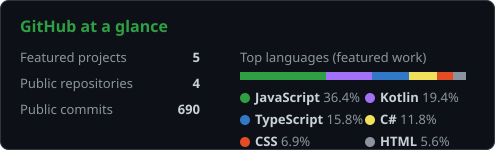

  

  

### About Me

A Computer and Information Science graduate who builds systems that connect networks, data, and people: APIs, integrations, access control, and the backend logic behind them.

- 🔐 Security first: JWT auth, RBAC, CSRF protection, rate limiting and audit logging on real projects
- 🌐 Networking: Fortinet NSE 1 & 2, working toward network automation and integrations
- 🌱 Currently learning: network fundamentals, NetBox and the Claude API

### Featured Projects

<!-- PROJECTS:START -->
| Project | What it is | My role | Stack |
|---|---|---|---|
| [GlobeWire](https://github.com/tjay-km/globewire) | International payment portal with customer and employee portals | Main developer: authentication, CSRF protection, rate limiting, tamper-evident audit logs | Next.js, TypeScript, MongoDB |
| [GoodLiving](https://github.com/GACoutts/XBCIS_WIL_Project) | Building management platform for Rawson Property Group (WIL project) | Led backend: MySQL schema, REST API, JWT and RBAC across 4 user roles | React, Node.js, Express, MySQL |
| [MixMate](https://github.com/GACoutts/OPSC_cocktail_app) | Offline-first Android cocktail discovery app | Designed every page, built the profile pages and the cocktail menu with offline-first support | Kotlin, Firebase |
<!-- PROJECTS:END -->

### Tech Stack

  
  
  
  
  
  
  
  
  
  
  
  
  

### GitHub Stats

  

Projects and stats refresh daily from public data via GitHub Actions.
